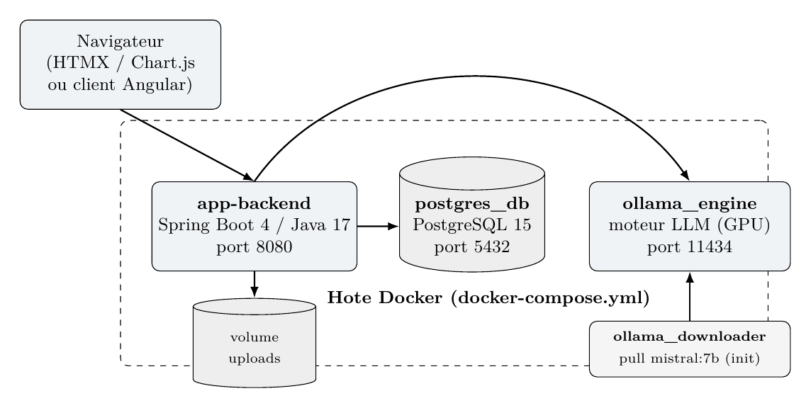
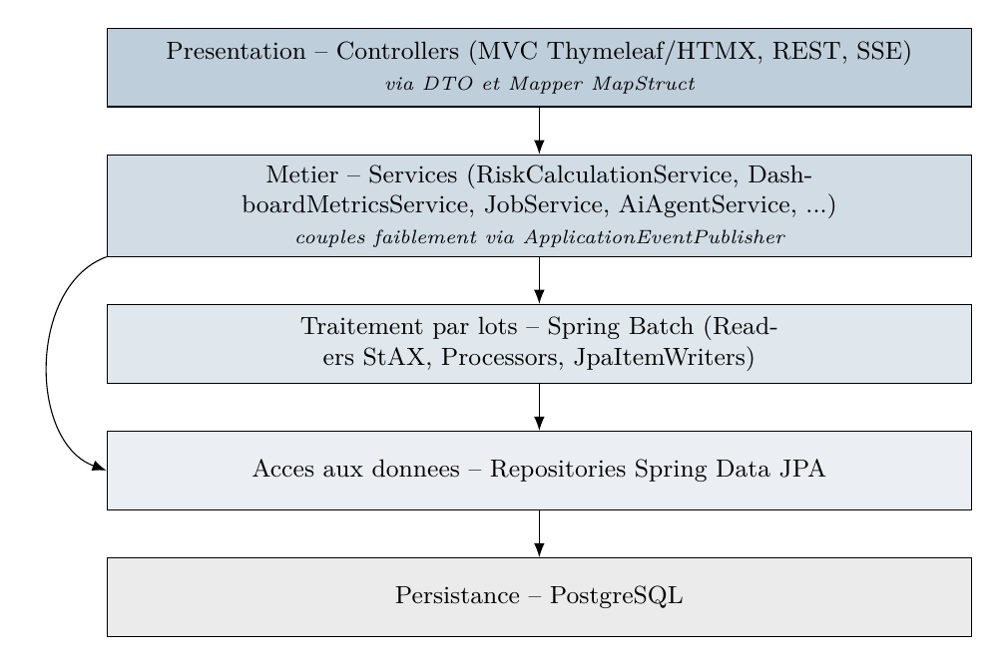
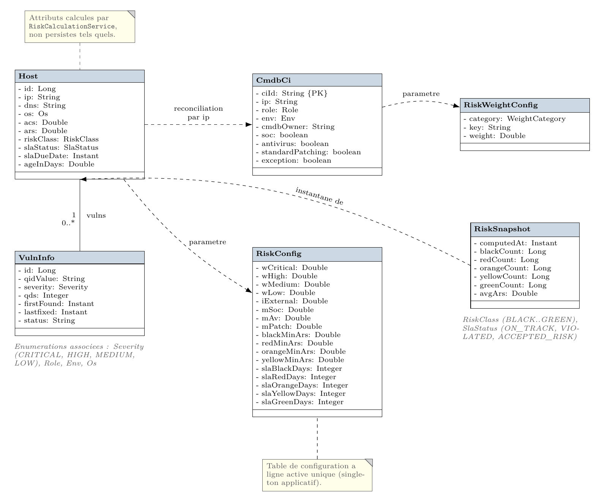
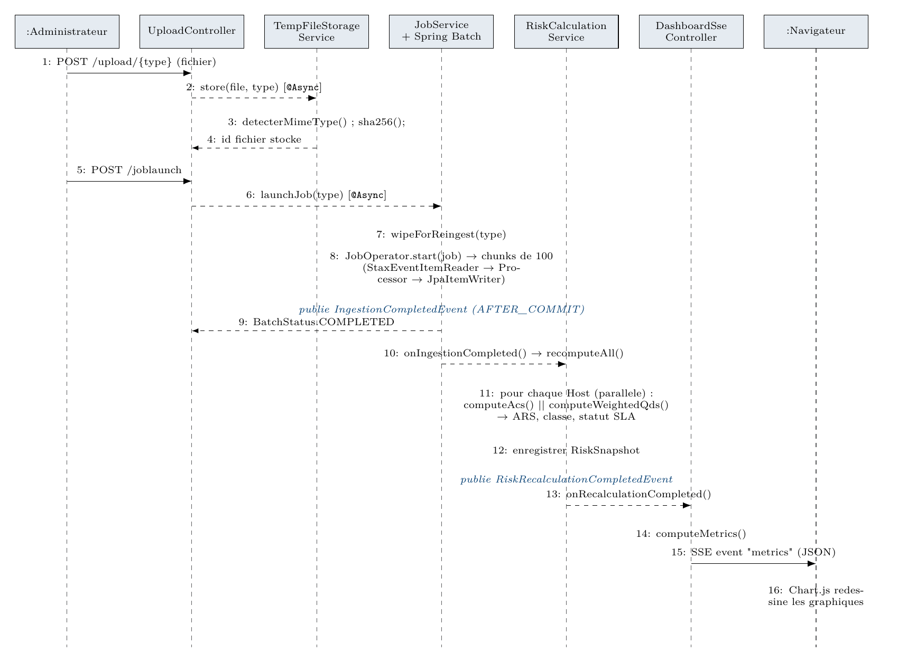
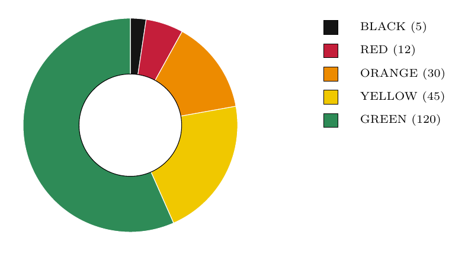
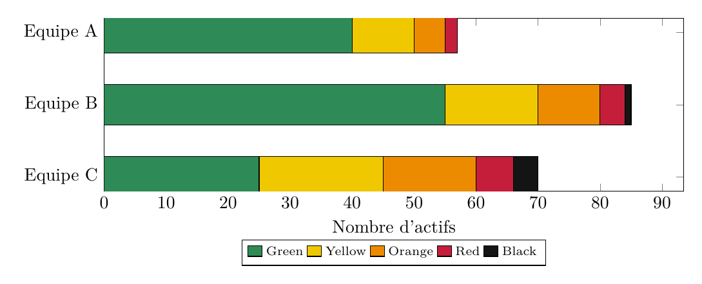
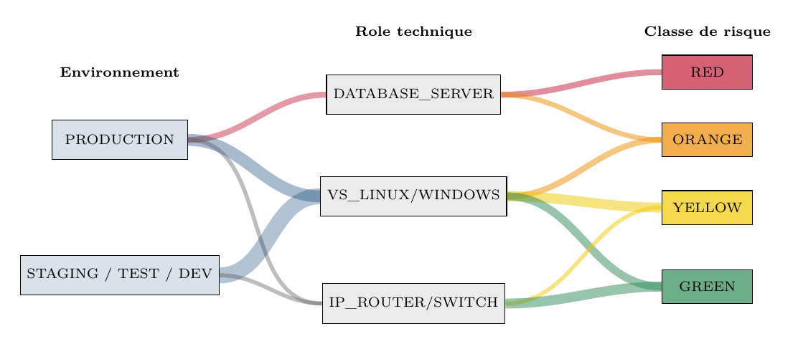
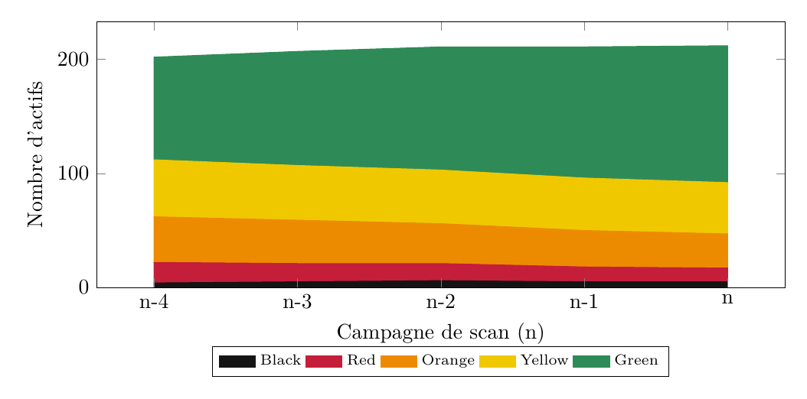
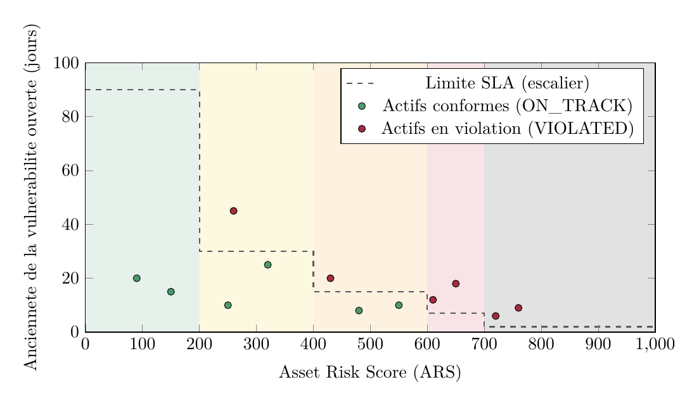

# RBVM — Risk-Based Vulnerability Management

A platform that cross-references **Qualys** vulnerability exports with the **CMDB** (business criticality of assets) to compute a contextualised risk score per asset, the **Asset Risk Score (ARS)**, and derive an operational governance layer from it: risk classes, SLA remediation deadlines and weighted MTTR.

> Final-year internship project (PFA), ENSA Marrakech — Université Cadi Ayyad, carried out at DXC Technology, 2025–2026.

## Why

Scanners like Qualys surface thousands of findings, but a raw technical severity (CVSS / QDS) does not reflect real risk: the same flaw does not carry the same impact on an isolated test server as on an Internet-facing production database. RBVM combines **what is vulnerable** (Qualys) with **how much it matters** (CMDB) and **how well it is protected** (SOC monitoring, antivirus/EDR, patching), so teams fix what matters first.

## Features

- **Secure, deduplicated ingestion**: real MIME detection with Apache Tika, SHA-256 hashing, so the same export is never processed twice.
- **Batch processing**: Spring Batch jobs stream Qualys and CMDB XML with StAX in 100-item chunks (MapStruct mappers, JPA writers).
- **Risk engine**: ACS, weighted QDS, ARS, risk class and SLA status computed in parallel per asset, triggered by an `AFTER_COMMIT` event once ingestion completes.
- **Configurable model**: severity weights, exposure/mitigation multipliers, class thresholds, SLA days and Role/Env weights are all editable from the UI.
- **Real-time dashboard**: Chart.js charts refreshed through Server-Sent Events after each recalculation, with no polling or page reload.
- **Asset drill-down**: a per-asset page explains how its score was computed, term by term.
- **AI assistant (prototype)**: a LangChain4j agent backed by a local Ollama model (`mistral:7b`) that answers questions by calling tools against the live database. No data leaves the host.

## Architecture



The application is a modular Spring Boot monolith, deployed with Docker Compose next to PostgreSQL and an Ollama inference engine. A one-shot `ollama-init` container pulls the model on first start.

<details>
<summary>Layered architecture</summary>



</details>

<details>
<summary>Domain model</summary>



</details>

### Ingestion → risk recalculation → dashboard



1. A file is uploaded and stored after its MIME type and hash are checked.
2. A Spring Batch job wipes the previous data of that source and re-ingests it. Each import is treated as the full current truth.
3. When the transaction commits, `IngestionCompletedEvent` triggers `RiskCalculationService.recomputeAll()`.
4. A `RiskSnapshot` is saved, and the new metrics are pushed to every open dashboard over SSE.

## Risk model

| Quantity | Formula |
|---|---|
| Asset Criticality Score | `ACS = 1 + 4 · (ρ(role) + ε(env)) / 2`, in [1, 5] |
| Weighted QDS | `Σᵢ wᵢ · avg(QDSᵢ) · nᵢ^(1/100)` over severities Critical / High / Medium / Low |
| Asset Risk Score | `ARS = min(ACS × WeightedQDS × I_External × M_SOC × M_AV × M_Patch, 1000)` |
| Weighted MTTR | `Σₖ wₖ Σ TTRₖ / Σₖ wₖ Cₖ`, excluding assets with an accepted-risk exception |

Default reference values:

| Factor | Condition | Value |
|---|---|---|
| `w_critical / w_high / w_medium / w_low` | severity weights | 1.0 / 0.2 / 0.05 / 0.01 |
| `I_External` | Internet-exposed (Qualys QID 45004) | 1.2 |
| `M_SOC` | monitored by the SOC | 0.8 |
| `M_AV` | EDR / antivirus present | 0.9 |
| `M_Patch` | excluded from the standard patch cycle | 1.3 |

| Class | ARS | Remediation SLA |
|---|---|---|
| ⬛ Black | ≥ 700 | 2 days |
| 🟥 Red | 600 – 699 | 7 days |
| 🟧 Orange | 400 – 599 | 15 days |
| 🟨 Yellow | 200 – 399 | 30 days |
| 🟩 Green | < 200 | 90 days |

An asset's SLA status is `VIOLATED` once its oldest open vulnerability exceeds the SLA of its class. If the CMDB flags the asset as an exception, the status is `ACCEPTED_RISK`: its ARS is unchanged, but the SLA clock is suspended.

The full derivation, with formal proofs of boundedness, monotonicity and well-defined classification, is in chapter 4 of the project report.

## Dashboard

*Charts below use illustrative data from the report. The live dashboard renders the imported Qualys/CMDB data.*

| Risk class distribution | Risk by owner team |
|---|---|
|  |  |

**Environment → Role → Risk class flow (Sankey)**: shows where risk concentrates structurally.



**Fleet history**: one stacked series per `RiskSnapshot`, to show whether posture improves across scan campaigns.



**SLA compliance**: each dot is an asset, plotted by ARS against the age of its oldest open vulnerability. Dots above the step line are in violation.



## Tech stack

| Layer | Technologies |
|---|---|
| Backend | Java 17, Spring Boot 4.1, Spring Batch, Spring Data JPA, Spring Security, Bean Validation |
| Ingestion | JAXB / Spring OXM, StAX, MapStruct, Apache Tika |
| Frontend | Thymeleaf, HTMX, Chart.js, Server-Sent Events |
| AI | LangChain4j, Ollama (`mistral:7b`) |
| Data | PostgreSQL 15 |
| Ops | Docker, Docker Compose (GPU reservation for Ollama) |

## Getting started

### Prerequisites

- JDK 17
- Docker and Docker Compose. Ollama is configured to use an NVIDIA GPU; remove the `deploy` block in `docker-compose.yml` to run it on CPU.

### 1. Configure the environment

Create a `.env` file at the project root:

```env
POSTGRES_USER=rbvm
POSTGRES_PASSWORD=change-me
POSTGRES_DB=rbvm

DATASOURCE_BASE_URL=jdbc:postgresql://db:5432/rbvm
DRIVER_CLASS_NAME=org.postgresql.Driver
DB_PLATFORM=org.hibernate.dialect.PostgreSQLDialect

OLLAMA_BASE_URL=http://ollama:11434
MODEL=mistral:7b
FILE_BASE_PATH=/app/uploads
```

> The defaults in `application.properties` target MySQL. Only the PostgreSQL driver is on the classpath, so the three datasource variables above are required.

### 2. Build and run

The Docker image copies a pre-built jar, so build it first:

```bash
cd backend/app
./mvnw clean package -DskipTests      # mvnw.cmd on Windows
cd ../..
docker compose up -d --build
```

The app is served at <http://localhost:8080>.

> `spring.jpa.hibernate.ddl-auto=create-drop` is set: the schema, and its data, is recreated on every restart.

### 3. Typical workflow

1. **Configure the model.** Set the Role and Env weights at `/riskCalcul/role` and `/riskCalcul/env`; the risk computation is skipped until both exist. Optionally tune the severity weights (`/riskCalcul/weights`), multipliers (`/riskCalcul/factors`) and SLA thresholds (`/riskCalcul/sla`).
2. **Import data.** Upload the CMDB and Qualys XML exports, then launch the jobs from `/joblaunch`. Samples are included: `CMDB_Completement_Anonymisee.xml` and `qualys_report_2026.xml`.
3. **Explore.** Open `/dashboard` for fleet-level metrics, or `/assets` to drill into an asset and its score breakdown.

## REST API

| Method | Endpoint | Description |
|---|---|---|
| `POST` | `/api/v1/upload/tempfile/{type}` | Upload a Qualys or CMDB XML file (`multipart/form-data`) |
| `POST` | `/api/v1/job/launchJob/{type}` | Launch the ingestion job for a source |
| `GET` | `/api/v1/assets` | Asset summaries with ARS, class and SLA status |
| `GET` | `/api/v1/dashboard/metrics` | Aggregated dashboard metrics |
| `GET` | `/api/v1/dashboard/stream` | SSE stream that pushes metrics after each recalculation |
| `GET` | `/api/v1/agent/ask?question=…` | Streamed answer from the AI agent |
| `POST/GET` | `/api/v1/riskCalcul/...` | Read and update risk configuration |

## Project structure

```
backend/app/src/main/java/ma/dxc/app/
├── config/        # Batch jobs, async executors, LangChain4j, security, Tika, OXM
├── controller/    # REST + SSE endpoints; render/ holds Thymeleaf/HTMX page controllers
├── service/       # Risk engine, dashboard metrics, jobs, AI agent, file storage
├── entity/        # Host, VulnInfo, CmdbCi, RiskConfig, RiskSnapshot, enums
├── dto/, mapper/  # XML/JSON DTOs and MapStruct mappers
├── event/         # Ingestion / config / recalculation domain events
├── repository/    # Spring Data JPA
└── validation/    # XML and MIME upload validators
docs/images/       # Figures used in this README
```

## Status and roadmap

- **Implemented**: ingestion pipeline, risk engine, configuration UI, real-time dashboard, asset drill-down.
- **Prototype**: the AI assistant works but has not been validated for staging or production.
- **Next**:
  - Wire the Enterprise Risk Score penalty (`Global_I_Ops`, driven by MTTR against an SLA target) into the dashboard. Today the dashboard shows the plain average ARS.
  - Keep CI history across imports.
  - Add authentication. All routes are currently open in `SecurityConfig`.

## Author

**Mohamed Amine Faik**, Cyber Defense & Embedded Telecommunication Systems engineering student, ENSA Marrakech.
